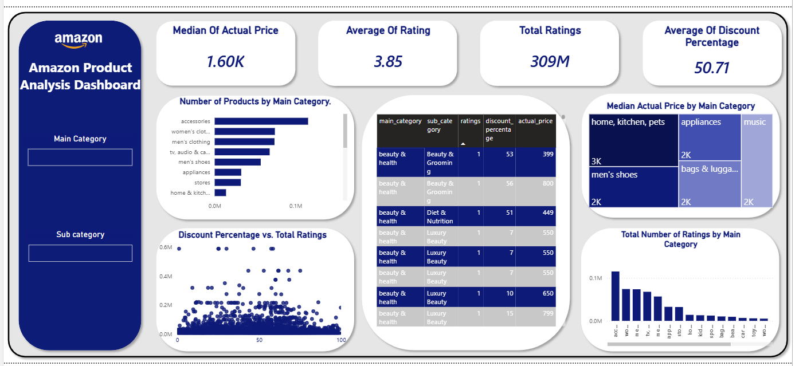

# Amazon Product Analysis

Portfolio project analyzing Amazon product pricing, discounts, ratings, and customer engagement with Python and Power BI.



## Project overview

The analysis covers data cleaning, preprocessing, exploratory data analysis, feature engineering, and dashboard development. It explores product and category patterns, including pricing, discounts, ratings, and customer engagement.

## Tools

- Python, Pandas, NumPy
- Matplotlib, Seaborn
- Jupyter Notebook
- Power BI

## Analysis workflow

- Removed duplicate records and prepared text and numeric fields.
- Reviewed missing, invalid, and outlier values.
- Compared actual prices, discounted prices, and discount percentages.
- Explored product ratings and rating counts across categories.
- Used log transformations for highly skewed numeric variables where useful.

## Questions explored

- Which categories contain the most products?
- Which categories have the highest median prices?
- How do discounts and ratings vary by category?
- How are discounts related to customer engagement?

## Dashboard

The Power BI dashboard summarizes median actual price, average rating, total ratings, average discount percentage, product counts, and ratings by category.

- **Preview:** see the image above (`images/amazon_dashboard.png`).
- **Interactive report:** download [`Dashbord/Amazon_dashbord.pbix`](Dashbord/Amazon_dashbord.pbix) and open it with Power BI Desktop. GitHub cannot preview `.pbix` files in the browser.

## Project files

```text
amazon-product-analysis/
├── Dashbord/
│   └── Amazon_dashbord.pbix
├── Notebook/
│   └── Amazon_Product_Analysis.ipynb
├── images/
│   └── amazon_dashboard.png
└── README.md
```
